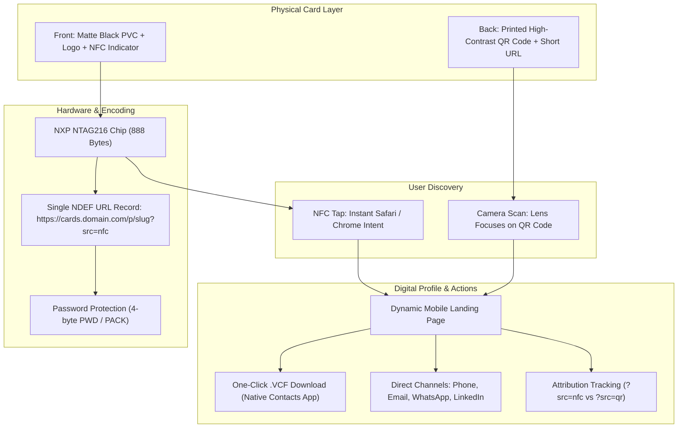

# Complete Implementation Plan: Digital NFC Cards with QR Fallback

This document outlines the end-to-end technical, physical, and operational plan for building, programming, and deploying digital complementary / business cards using **Black NTAG216 PVC cards (85.6 × 54 mm, 888 bytes)** with **high-contrast QR codes as a physical fallback**.

---

## 1. System Architecture Overview



---

## 2. Bill of Materials & Procurement

| Item | Specification | Purpose | Estimated Cost |
| :--- | :--- | :--- | :--- |
| **NFC Cards** | Black PVC, NXP NTAG216 (888 bytes), CR80 (85.60 × 53.98 mm, 0.84 mm thickness), ISO 14443-A | Physical contactless card body | ~$0.60 – $1.20 / card (packs of 10–50 on Amazon/AliExpress) |
| **Programming Device** | NFC-enabled smartphone (iPhone 7+ or modern Android) | Card encoding via NFC Tools | $0 (existing phone) |
| **Programming App** | **NFC Tools** by wakdev (iOS / Android) | Writing NDEF records and applying password locks | Free (or $2.99 for Pro for CSV batching) |
| **QR Code Printing** | Matte white waterproof vinyl stickers or UV flatbed printing | High-contrast QR fallback on black background | ~$5–$15 for sticker sheets or local print |
| **Web Hosting** | Cloudflare Pages, GitHub Pages, Vercel, or custom server | Hosting the dynamic profile and `.vcf` file | 100% Free tier |

---

## 3. Physical Layout & Artwork Specifications

Standard CR80 dimensions apply: **85.6 mm × 53.98 mm**.

### Card Layout Blueprint

```
◄─────────────────────────── 85.6 mm (3.37") ───────────────────────────►
┌──────────────────────────────────────────────────────────────────────┐ ▲
│  [ SAFE PRINT ZONE: Keep all critical text 3 mm inside outer edge ]   │ │
│                                                                      │ │
│               ┌──────────────────┐                                   │ │
│               │                  │                                   │ │
│               │   COMPANY LOGO   │                                   │ │
│               │                  │                                   │ │
│               └──────────────────┘                                   │ 54 mm
│                                                                      │ (2.13")
│                     Jane Doe                                         │ │
│                 Managing Director                                    │ │
│                                                                      │ │
│                   (((  ·  )))                                        │ │
│               TAP CARD TO PHONE                                      │ │
│                                                                      │ │
└──────────────────────────────────────────────────────────────────────┘ ▼
                               FRONT SIDE

┌──────────────────────────────────────────────────────────────────────┐
│                                                                      │
│    ┌───────────────┐                                                 │
│    │  █████ ▄▄ ███ │                                                 │
│    │  █   █ █  █ █ │    SCAN QR CODE                                 │
│    │  █████ ▀▀ ███ │    IF TAP FAILS                                 │
│    │  ▄▄▄ ▄ ▀▀ ▄ ▄ │                                                 │
│    │  ██ ██ █▀ █ █ │    yourdomain.com/p/jane                        │
│    └───────────────┘                                                 │
│    ◄── 20 mm ──►                                                     │
│                                                                      │
└──────────────────────────────────────────────────────────────────────┘
                                BACK SIDE
```

### Critical Rules for Black Cards:
1. **QR Contrast Requirement:** Desktop printers cannot print white ink. Do **not** print dark QR codes directly onto black plastic.
2. **Solid White Backing:** Print the QR code on a **solid white square** with a **2 mm white quiet zone** around all four sides.
3. **Minimum QR Size:** **18 mm × 18 mm** (0.7" × 0.7"). Ideal is **20 mm × 20 mm**.
4. **Antenna Loop:** The internal antenna runs around the outer perimeter of the card. The card can be tapped from either side (front or back).

---

## 4. Software Stack & File Deliverables

### A. Mobile Profile Webpage (`index.html`)

Save and host this file at your profile route (e.g., `https://cards.yourdomain.com/p/jane/`):

```html
<!DOCTYPE html>
<html lang="en">
<head>
  <meta charset="UTF-8" />
  <meta name="viewport" content="width=device-width, initial-scale=1.0" />
  <title>Jane Doe | Contact</title>
  <style>
    :root {
      --bg: #0f172a;
      --card-bg: #1e293b;
      --text-main: #f8fafc;
      --text-sub: #94a3b8;
      --accent: #2563eb;
      --accent-hover: #1d4ed8;
      --btn-secondary: #334155;
    }
    * { box-sizing: border-box; margin: 0; padding: 0; font-family: -apple-system, BlinkMacSystemFont, "Segoe UI", Roboto, sans-serif; }
    body {
      background-color: var(--bg);
      color: var(--text-main);
      display: flex;
      justify-content: center;
      padding: 2.5rem 1rem;
      min-height: 100vh;
    }
    .profile-card {
      background: var(--card-bg);
      width: 100%;
      max-width: 400px;
      border-radius: 24px;
      padding: 2rem 1.5rem;
      text-align: center;
      box-shadow: 0 20px 25px -5px rgba(0, 0, 0, 0.5);
      border: 1px solid rgba(255, 255, 255, 0.08);
      height: fit-content;
    }
    .avatar {
      width: 104px;
      height: 104px;
      border-radius: 50%;
      object-fit: cover;
      margin-bottom: 1rem;
      border: 3px solid var(--accent);
    }
    h1 { font-size: 1.4rem; font-weight: 700; margin-bottom: 0.25rem; }
    .title { color: var(--text-sub); font-size: 0.95rem; margin-bottom: 1.5rem; }
    
    .btn-save {
      display: block;
      width: 100%;
      background: var(--accent);
      color: #ffffff;
      text-decoration: none;
      font-weight: 600;
      padding: 0.85rem;
      border-radius: 14px;
      margin-bottom: 1.5rem;
      font-size: 1rem;
      transition: background 0.2s;
    }
    .btn-save:hover { background: var(--accent-hover); }

    .links { display: flex; flex-direction: column; gap: 0.75rem; }
    .link-item {
      display: flex;
      align-items: center;
      justify-content: space-between;
      background: var(--btn-secondary);
      color: var(--text-main);
      text-decoration: none;
      padding: 0.85rem 1.2rem;
      border-radius: 12px;
      font-size: 0.95rem;
      font-weight: 500;
      transition: transform 0.1s, opacity 0.2s;
    }
    .link-item:hover { opacity: 0.9; transform: translateY(-1px); }
    .source-tag { font-size: 0.75rem; color: var(--text-sub); margin-top: 1.5rem; }
  </style>
</head>
<body>

  <main class="profile-card">
    
    <h1>Jane Doe</h1>
    <p class="title">Founder & CEO • Acme Studio</p>

    <a href="contact.vcf" download class="btn-save">
      💾 Save to Contacts
    </a>

    <div class="links">
      <a href="tel:+15550199222" class="link-item">
        <span>📞 Phone</span>
        <span>+1 (555) 019-9222</span>
      </a>
      <a href="mailto:jane@acmestudio.example" class="link-item">
        <span>✉️ Email</span>
        <span>jane@acmestudio.example</span>
      </a>
      <a href="https://linkedin.com/in/janedoe" target="_blank" rel="noopener" class="link-item">
        <span>💼 LinkedIn</span>
        <span>/in/janedoe</span>
      </a>
      <a href="https://acmestudio.example" target="_blank" rel="noopener" class="link-item">
        <span>🌐 Website</span>
        <span>acmestudio.example</span>
      </a>
    </div>

    <p class="source-tag" id="channel-indicator"></p>
  </main>

  <script>
    const params = new URLSearchParams(window.location.search);
    const src = params.get('src');
    const indicator = document.getElementById('channel-indicator');
    if (src === 'nfc') {
      indicator.textContent = "Connected via NFC Tap ✨";
    } else if (src === 'qr') {
      indicator.textContent = "Connected via QR Scan 📷";
    }
  </script>
</body>
</html>
```

---

### B. Standard Contact File (`contact.vcf`)

Place this in the same folder as `index.html`:

```text
BEGIN:VCARD
VERSION:3.0
N:Doe;Jane;;;
FN:Jane Doe
ORG:Acme Studio;
TITLE:Founder & CEO
TEL;TYPE=CELL,VOICE:+15550199222
EMAIL;TYPE=WORK,INTERNET:jane@acmestudio.example
URL;TYPE=WORK:https://acmestudio.example
X-SOCIALPROFILE;TYPE=linkedin:https://linkedin.com/in/janedoe
NOTE:Met via NFC / QR digital card
END:VCARD
```

---

### C. Server MIME Headers (Prevents Raw Text Display)

Ensure your web server returns the correct MIME type so iOS and Android automatically open the native Contacts app:

#### Nginx Configuration:
```nginx
location ~* \.vcf$ {
    default_type text/vcard;
    add_header Content-Disposition 'attachment; filename="contact.vcf"';
    add_header Cache-Control "no-cache, no-store, must-revalidate";
}
```

#### Apache (`.htaccess`):
```apache
<FilesMatch "\.(vcf|vcard)$">
    ForceType text/vcard
    Header set Content-Disposition "attachment"
    Header set Cache-Control "no-cache, no-store, must-revalidate"
</FilesMatch>
```

#### Vercel / Cloudflare (`vercel.json`):
```json
{
  "headers": [
    {
      "source": "/(.*)\\.vcf",
      "headers": [
        { "key": "Content-Type", "value": "text/vcard; charset=utf-8" },
        { "key": "Content-Disposition", "value": "attachment" }
      ]
    }
  ]
}
```

---

### D. QR Code Generation Script (`generate_qr.py`)

Run this script to output high-resolution, camera-ready QR codes with solid white backplates for black cards:

```python
import qrcode

def generate_card_qr(slug: str, base_url: str = "https://cards.yourdomain.com"):
    target_url = f"{base_url}/p/{slug}?src=qr"

    qr = qrcode.QRCode(
        version=1,
        error_correction=qrcode.constants.ERROR_CORRECT_M,
        box_size=15,
        border=4,  # 4-module quiet zone (mandatory white border)
    )

    qr.add_data(target_url)
    qr.make(fit=True)

    img = qr.make_image(fill_color="black", back_color="white")
    filename = f"qr_{slug}.png"
    img.save(filename)
    print(f"Generated QR code: {filename} -> {target_url}")

if __name__ == "__main__":
    generate_card_qr("jane")
```

---

## 5. Step-by-Step Programming Guide (NFC Tools)

Follow this procedure to encode each blank Black NTAG216 card:

1. **Launch App:** Open **NFC Tools** on Android or iOS.
2. **Add Record:** Tap **Write** ➔ **Add a record** ➔ **URL / URI**.
3. **Select Protocol:** Choose `https://` from the dropdown.
4. **Enter Address:** Type `cards.yourdomain.com/p/jane?src=nfc` and tap **OK**.
   * *Notice payload size: approximately 40–50 bytes out of 888 bytes capacity.*
5. **Write Tag:** Tap **Write / [X] Bytes**.
6. **Tap Card:**
   * **On iPhone:** Tap card against the **very top rim** on the back of the phone.
   * **On Android:** Tap card against the **center of the back panel**.
   * Hold still until the green checkmark and success chime trigger.
7. **Set Write Password:**
   * In NFC Tools, switch to the **Other** tab.
   * Tap **Set password**.
   * Enter an 8-character hex password (e.g., `A1B2C3D4`) and leave PACK as `0000`.
   * Tap card again to protect it from being overwritten.
   * *(Do NOT tap "Lock permanently" — keep it password-protected so you can re-flash it later).*

---

## 6. Device Testing & Quality Assurance Protocol

Run this 4-point verification checklist before handing cards out:

- [ ] **iPhone Background NFC Test:**
  * Lock an iPhone XS or newer. Wake screen (lock screen lit).
  * Tap card to top edge. Confirm native Safari notification appears in < 1 second.
- [ ] **Android Background NFC Test:**
  * Ensure NFC toggle is ON in quick settings.
  * Tap card to center back. Confirm browser immediately opens page with haptic chime.
- [ ] **QR Code Fallback Test:**
  * Open default camera app on both iOS and Android.
  * Hold 15–20 cm away from the printed QR code under normal and low-light conditions.
  * Verify URL resolves with `?src=qr`.
- [ ] **Contact Save Test:**
  * Tap **"Save to Contacts"** on the mobile browser.
  * Verify that the native Contacts sheet opens with name, phone, email, and company cleanly filled out.

---

## 7. Future Expansion Roadmap

1. **Digital Wallet Passes:** Add dynamic **Apple Wallet (`.pkpass`)** and **Google Wallet** download links to the profile page.
2. **Two-Way Lead Capture:** Add a 3-field contact exchange form on the landing page that alerts you via Telegram/Slack or syncs directly to your CRM.
3. **USB Batch Encoding:** Transition from manual smartphone tapping to an **ACR122U USB reader** and Python script if scaling to 50+ employee cards.

